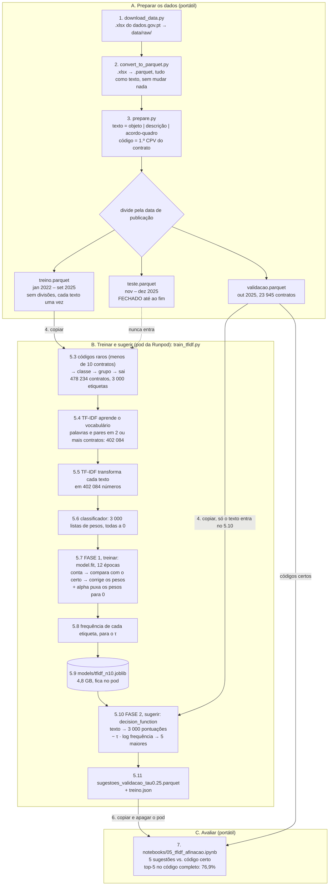

# Como funciona o modelo TF-IDF, passo a passo

Explicação do modelo da história E4-H1 (`src/tfidf.py`), do texto às 5 sugestões. Há um só exemplo do princípio ao fim, com um modelo de brincar: **4 palavras e 3 códigos**. **Os números do exemplo são inventados**, só para mostrar as contas. Os números do modelo real (secção 7) vêm de `metrics/e4_h1/treino.json`.

---

## 1. A ideia em três frases

1. O computador não percebe texto, só faz contas. Por isso o texto é primeiro transformado em números: é o **TF-IDF**.
2. Depois, para cada código CPV, faz-se uma conta com esses números que dá a resposta a "este texto é deste código?". Isto é o **classificador**.
3. Os 5 códigos com a resposta mais forte são as **sugestões**.

```
texto ──► TF-IDF ──► números do texto ──► classificador ──► um número por código ──► 5 maiores = sugestões
```

---

## 2. Uma comparação: o cesto de compras

Para separar as duas coisas que costumam baralhar-se:

- Tens um **cesto de compras**: 2 kg de maçãs e 1 kg de pão. O cesto diz **quanto** tens de cada coisa.
- Há **três lojas** e cada uma tem a sua **tabela de preços**.
- Para saber quanto pagavas em cada loja, multiplicas a quantidade de cada coisa pelo preço dessa loja e somas.

No modelo:

| Compras | Modelo |
|---|---|
| cesto (quanto há de cada coisa) | **números do TF-IDF**: quanto o texto fala de cada palavra |
| uma loja | **um código CPV** (um classificador) |
| tabela de preços da loja | **pesos do classificador**: quanto cada palavra conta para esse código |
| conta final em cada loja | **pontuação** do código |

O cesto vem **do texto** e muda a cada texto. Os preços vêm **do treino** e ficam fixos depois de treinar. São duas listas de números diferentes, que só se juntam na multiplicação.

---

## 3. Peça 1: o TF-IDF descreve o texto

Texto do exemplo: **"serviços de limpeza de escolas"**

No modelo de brincar, o vocabulário (as palavras que o modelo conhece) só tem 4 palavras. O TF-IDF dá um número a cada uma:

| limpeza | escolas | refeições | estradas |
|---|---|---|---|
| 0,8 | 0,6 | 0 | 0 |

- Uma palavra que não está no texto fica com **0**.
- Uma palavra que aparece em quase todos os contratos ("de", "serviços") ajuda pouco a distinguir códigos, por isso recebe um número baixo. Aqui nem entra no vocabulário, para simplificar.

O TF-IDF **não sabe nada de códigos CPV**. Só descreve o texto.

No código é a peça `"tfidf"` (`TfidfVectorizer`) em `src/tfidf.py:57`.

---

## 4. Peça 2: o classificador

### 4.1 Um classificador por código

O modelo tem um classificador para cada código. Cada um responde só à sua pergunta, de **sim ou não**:

- classificador **L** (limpeza, `90910000`): "este texto é de limpeza?"
- classificador **R** (refeições escolares, `55524000`): "este texto é de refeições escolares?"
- classificador **E** (um código de estradas): "este texto é de estradas?"

Isto chama-se **um-contra-todos** (*one-vs-rest*): cada código contra todos os outros.

### 4.2 Cada classificador é uma tabela de preços

Cada classificador é **uma lista de números, um por palavra**, chamados **pesos**:

- peso **positivo**: a palavra aponta para "sim";
- peso **negativo**: aponta para "não";
- peso **perto de 0**: a palavra não ajuda a decidir.

Pesos do modelo de brincar, já treinado (a secção 6 mostra de onde vêm):

| Palavra | Classificador L (limpeza) | Classificador R (refeições) | Classificador E (estradas) |
|---|---|---|---|
| limpeza | **+2,5** | −3 | −4 |
| escolas | +0,3 | +0,3 | −2,3 |
| refeições | (não entra nesta conta) | | |
| estradas | (não entra nesta conta) | | |

(As palavras que valem 0 no texto não contam na conta, porque 0 × peso = 0. Por isso não pus os pesos delas.)

No código é a peça `"clf"` (`SGDClassifier`) em `src/tfidf.py:58`. Os pesos estão no atributo `coef_`.

---

## 5. Usar o modelo: do texto às sugestões

### Conta 1: pontuação = números do texto × pesos, somados

| Classificador | Conta | Pontuação |
|---|---|---|
| L | 0,8 × 2,5 + 0,6 × 0,3 | **+2,18** |
| R | 0,8 × (−3) + 0,6 × 0,3 | **−2,22** |
| E | 0,8 × (−4) + 0,6 × (−2,3) | **−4,58** |

(O modelo real soma ainda um número fixo por classificador, o **intercepto**. Fica de fora para as contas serem curtas.)

No código: `model.decision_function(...)`, `src/tfidf.py:108`.

### Conta 2: a sigmoide põe a pontuação entre 0 e 1

A **sigmoide** é uma fórmula fixa, 1 / (1 + e^(−pontuação)), que transforma qualquer pontuação num número entre 0 e 1:

| Classificador | Pontuação | Número | Resposta |
|---|---|---|---|
| L | +2,18 | **0,90** | **sim** |
| R | −2,22 | **0,10** | **não** |
| E | −4,58 | **0,01** | **não**, com força |

- Perto de 1 quer dizer **sim**, 0,5 quer dizer **não sei** e perto de 0 quer dizer **não**.
- A sigmoide nunca dá exatamente 0 nem exatamente 1.

### Conta 3: as sugestões

Ordenam-se os códigos do número maior para o menor e ficam os primeiros 5 (aqui só há 3):

1. L, limpeza
2. R, refeições
3. E, estradas

O modelo **dá sempre 5 sugestões**, mesmo que todos os classificadores digam "não": nesse caso sugere os 5 que disseram "não" com menos força. Nunca responde "não sei".

No código: `top_k`, `src/tfidf.py:66`. Em caso de empate, ganha o menor código.

---

## 6. Treinar: de onde vêm os pesos

### 6.1 Treinar é descobrir os pesos

Antes do treino, **os pesos estão todos a 0**. Com tudo a 0, a pontuação dá sempre 0 e a sigmoide dá sempre 0,5: o modelo não tem opinião nenhuma.

Treinar é mostrar ao modelo contratos **com o código certo** e corrigir os pesos sempre que ele erra.

### 6.2 A regra de correção

Para cada exemplo de treino e para cada classificador:

> **erro** = resposta certa − número que o classificador deu
> (resposta certa = **1** se o código do exemplo é o deste classificador, **0** se não é)
>
> **peso novo** = peso + erro × número da palavra no texto

- Se o classificador disse "sim" **de menos**, o erro é positivo e os pesos das palavras do texto **sobem**.
- Se disse "sim" **a mais**, o erro é negativo e os pesos **descem**.
- As palavras que não estão no texto valem 0 e os pesos delas não mudam.

### 6.3 Exemplo de treino 1: "limpeza de escolas", código certo **L**

Números do TF-IDF: limpeza 0,8 · escolas 0,6 · refeições 0 · estradas 0.

Os pesos ainda estão a 0, por isso todos os classificadores dão 0,5.

| Classificador | Resposta certa | Deu | Erro | Peso de limpeza | Peso de escolas |
|---|---|---|---|---|---|
| L | 1 | 0,5 | +0,5 | 0 + 0,5 × 0,8 = **+0,4** | 0 + 0,5 × 0,6 = **+0,3** |
| R | 0 | 0,5 | −0,5 | **−0,4** | **−0,3** |
| E | 0 | 0,5 | −0,5 | **−0,4** | **−0,3** |

### 6.4 Exemplo de treino 2: "refeições escolares para escolas", código certo **R**

Números do TF-IDF: limpeza 0 · escolas 0,6 · refeições 0,8 · estradas 0.

| Classificador | Pontuação (pesos atuais) | Deu | Resposta certa | Erro | Peso de escolas | Peso de refeições |
|---|---|---|---|---|---|---|
| L | 0,6 × 0,3 = +0,18 | 0,545 | 0 | −0,545 | 0,3 − 0,327 = **−0,027** | **−0,436** |
| R | 0,6 × (−0,3) = −0,18 | 0,455 | 1 | +0,545 | −0,3 + 0,327 = **+0,027** | **+0,436** |
| E | 0,6 × (−0,3) = −0,18 | 0,455 | 0 | −0,455 | −0,3 − 0,273 = **−0,573** | **−0,364** |

### 6.5 Os pesos depois dos 2 exemplos

| Palavra | L | R | E |
|---|---|---|---|
| limpeza | **+0,4** | −0,4 | −0,4 |
| escolas | −0,027 | +0,027 | −0,573 |
| refeições | −0,436 | **+0,436** | −0,364 |
| estradas | 0 | 0 | 0 |

Ninguém escreveu a regra "limpeza aponta para L", mas os pesos já a mostram. "escolas" quase não conta em L nem em R, porque apareceu nos dois. "estradas" continua a 0, porque nenhum exemplo tinha essa palavra.

Passar uma vez por todos os exemplos chama-se uma **época**. O treino faz várias épocas e, com milhares de exemplos, os pesos chegam a valores como os da secção 4 (+2,5, −3...).

### 6.6 Os pormenores do treino real

- **Taxa de aprendizagem**: o tamanho de cada correção. Aqui usei 1. Na prática é muito menor, para cada exemplo não estragar o que os anteriores ensinaram.
- **Regularização** (o parâmetro `alpha`): uma regra que impede os pesos de crescerem demais. Sem ela, o modelo decorava os exemplos de treino em vez de aprender regras que servem para textos novos.
- **SGD** (*stochastic gradient descent*, descida de gradiente estocástica): o nome desta maneira de corrigir os pesos aos poucos, exemplo a exemplo. Daí o nome `SGDClassifier`.
- **`log_loss`**: a medida de erro que o treino tenta baixar. Com ela, o classificador é uma **regressão logística** (pesos + soma + sigmoide).
- **O TF-IDF também aprende no treino**: é dos textos de treino que tira o vocabulário e a importância de cada palavra. Por isso a validação e o teste nunca entram no treino.

No código, o treino todo é uma linha: `model.fit(...)`, `src/tfidf.py:60`. Primeiro o TF-IDF aprende o vocabulário e transforma os textos em números; depois o classificador corrige os pesos.

---

## 7. O modelo real

É igual ao de brincar, mas maior. Os números vêm de `metrics/e4_h1/treino.json`:

| | Modelo de brincar | Modelo real |
|---|---|---|
| palavras e pares de palavras no vocabulário | 4 | **402 084** (`vocabulario`) |
| códigos (classificadores) | 3 | **3 000** (`etiquetas`) |
| exemplos de treino | 2 | **478 234** (`exemplos_usados`) |
| épocas | 1 | **6** (`n_iter`) |
| pesos | 4 × 3 = 12 | 402 084 × 3 000 ≈ 1 200 milhões, ocupam **4 825 008 000 bytes** (`coef_bytes`), cerca de 4,8 GB |

Antes do treino, os códigos com menos de 10 exemplos são trocados por um código mais geral (a classe ou o grupo), porque o modelo aprende mal com tão poucos exemplos. É o `collapse_rare_codes` (`src/labels.py`), chamado em `src/tfidf.py:50`.

---

## 8. Onde vive o modelo

1. O `src/train_tfidf.py` corre **no pod da Runpod**. O treino é a linha 106 (`tfidf.train(...)`).
2. O modelo treinado, com todos os pesos, é gravado em `models/tfidf_n10.joblib` no disco do pod (linha 116, `joblib.dump`).
3. Ainda no pod, o modelo sugere 5 códigos para cada contrato da validação. O resultado vai para `metrics/e4_h1/sugestoes_validacao.parquet` (linhas 121-127).
4. Para o portátil só vêm os resultados (`sugestoes_validacao.parquet`, `treino.json`, `sugestoes_exemplos.txt`). O modelo (4,8 GB) não cabe na memória do portátil.
5. No portátil, o `notebooks/04_tfidf.ipynb` compara as sugestões com os códigos certos e com a régua.

Em todo o projeto, com o modelo por defeito (`alpha` e τ do E4-S4). Os números vêm de `metrics/e4_s4/alpha_1e-7/treino.json` e o top-5 da secção 14 do `qualidade_dados.md`:



O treino propriamente dito vai do 5.3 ao 5.9 (as secções 3 e 6 explicam o 5.4 a 5.7, e a secção 5 o 5.10): o que vem antes prepara os dados e o que vem depois usa e avalia o modelo. O modelo do E4-H1 (`alpha` = 0,0001, secção 7) parou ao fim de 6 épocas; com o `alpha` do E4-S4, mais fraco, o treino faz 12 antes de parar.

Na palavra "pipeline" há dois sentidos: o `Pipeline` do scikit-learn são as duas peças do modelo (TF-IDF + classificador); "o pipeline" no `CLAUDE.md` é este caminho todo, dos dados à avaliação.

---

## 9. A "probabilidade" em `sugestoes_exemplos.txt`

O `src/suggest.py` escreve ao lado de cada sugestão um número que chama "probabilidade". Sai de `model.predict_proba(...)` (`src/suggest.py:34`), que faz isto:

1. calcula o número entre 0 e 1 de **cada** classificador (secção 5, conta 2);
2. divide cada um pela **soma de todos**, para que somem 1.

No modelo de brincar: 0,90 + 0,10 + 0,01 ≈ 1,007. Então a L fica com 0,898 / 1,007 ≈ **0,89**.

No modelo real há 3 000 classificadores. Os que dizem "não" dão números pequenos, mas nunca 0. Se os outros 2 997 derem 0,007 cada um (valor inventado), a soma passa a ser cerca de 22, e a mesma L fica com 0,898 / 22 ≈ **0,04**. É por isso que o ficheiro mostra 0,013 na 1.ª sugestão: são milhares de "nãos" pequenos somados.

Como ler o ficheiro:

- **A ordem é o que conta**: o código com o número maior é o que o modelo prefere.
- **O valor não é "a probabilidade de estar certo"**. Para isso o modelo teria de estar **calibrado** (dos casos em que diz 0,8, acertar em cerca de 80 %), e isso não foi medido.
- Números quase iguais nas 5 sugestões (por exemplo, 0,002 a 0,005 na repavimentação de estradas) querem dizer que o modelo não tem uma preferência clara.

---

## 10. Glossário

| Termo | O que é |
|---|---|
| **vocabulário** | as palavras e pares de palavras que o modelo conhece, tiradas do treino |
| **TF-IDF** | transforma um texto num número por palavra do vocabulário: alto se a palavra aparece no texto e é rara nos outros contratos |
| **etiqueta** | a resposta certa de um exemplo de treino (aqui, o código CPV) |
| **classificador** | uma lista de pesos, um por palavra, que responde a uma pergunta de sim ou não |
| **um-contra-todos** | um classificador por código, cada um a decidir "este código ou outro qualquer" |
| **peso** (coeficiente) | quanto uma palavra conta para o "sim" de um código; aprendido no treino (`coef_`) |
| **intercepto** | número fixo somado à pontuação de cada classificador (`intercept_`) |
| **pontuação** | números do texto × pesos, somados (+ intercepto) (`decision_function`) |
| **sigmoide** | fórmula que transforma a pontuação num número entre 0 (não) e 1 (sim) |
| **treinar** (`fit`) | corrigir os pesos com exemplos de treino até o modelo acertar |
| **época** | uma passagem por todos os exemplos de treino |
| **taxa de aprendizagem** | o tamanho de cada correção dos pesos |
| **regularização** (`alpha`) | regra que impede os pesos de crescerem demais e decorarem o treino |
| **SGD** | maneira de corrigir os pesos aos poucos, exemplo a exemplo |
| **regressão logística** | classificador feito de pesos + soma + sigmoide |
| **calibrado** | quando o número do modelo corresponde à percentagem de acertos |
| **`Pipeline`** | objeto do scikit-learn que junta o TF-IDF e o classificador e os usa sempre por esta ordem |

---

## 11. O que se aplica fora do CPV

- Quase todos os classificadores são isto: **descrever a entrada com números** e **fazer uma conta com pesos aprendidos**. No BERTimbau e na Albertina, a descrição do texto passa a ser feita por uma rede neuronal em vez do TF-IDF, mas a última peça é igual à da secção 5.
- **Treinar** muda os pesos e só usa dados de treino. **Usar** o modelo só lê os pesos, sem os mudar.
- Um modelo que devolve um top-5 dá sempre uma resposta. Para poder responder "não sei", é preciso acrescentar uma regra por cima (por exemplo, "se o número maior for menor que X, não sugerir").
- Um número a que o modelo chama "probabilidade" só quer dizer "acerta X % das vezes" se o modelo estiver calibrado, e isso tem de ser medido.
