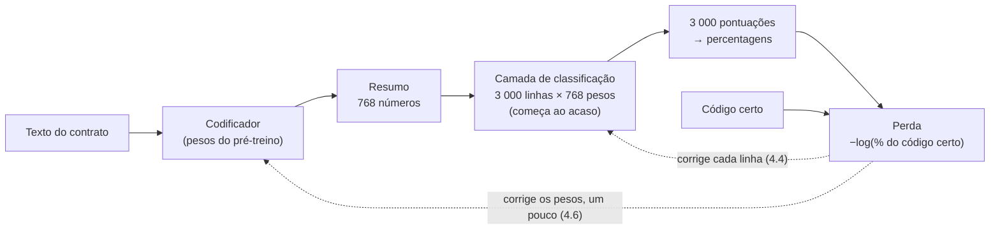

# O treino do BERT, passo a passo

Como é, por dentro, a última camada do modelo (a **camada de classificação**) e o que lhe acontece num passo de treino, com contas que se fazem à mão. O documento [`como_funciona_bert.md`](como_funciona_bert.md) dá o contexto (pré-treino, onde está cada peça no código). Este concentra-se só no treino.

Os números marcados como **ilustrativos** são inventados para se poderem fazer as contas. Os números reais vêm de [`metrics/bert/e5_t4_bertimbau/treino.json`](../metrics/bert/e5_t4_bertimbau/treino.json), o primeiro treino do BERTimbau (E5-T4).

## 1. O caminho de um texto, do início ao fim

```
"Fornecimento de refeições escolares"
        │
        ▼
┌──────────────────────────────┐
│ CODIFICADOR (o BERT)         │  12 camadas, pesos do pré-treino
│ transforma o texto em        │
│ 768 números: o RESUMO        │
└──────────────────────────────┘
        │   resumo = [0,12  −1,30  0,87  ...  0,05]   (768 números)
        ▼
┌──────────────────────────────┐
│ CAMADA DE CLASSIFICAÇÃO      │  uma tabela de pesos,
│ dá uma PONTUAÇÃO a cada      │  uma linha por código CPV
│ código CPV                   │
└──────────────────────────────┘
        │   3 000 pontuações, uma por código
        ▼
   as 5 maiores = as 5 sugestões
```

O codificador não sabe nada de códigos CPV: só transforma texto em números. Quem fala de códigos CPV é a camada de classificação, a última peça do modelo.

## 2. A camada de classificação é uma tabela

Para as contas caberem no papel, uso um **resumo de 3 números** em vez de 768 e **3 códigos** em vez de 3 000:

- A = 55524000, refeições escolares
- B = 30192000, material de escritório
- C = 90910000, serviços de limpeza

A camada de classificação é uma tabela com **uma linha por código**. Cada linha tem tantos pesos quantos os números do resumo (aqui 3, no modelo real 768):

```
              peso 1   peso 2   peso 3
código A:  [   0,2      0,1     −0,1  ]
código B:  [  −0,1      0,3      0,2  ]
código C:  [   0,1     −0,2      0,0  ]
```

(ilustrativo)

### Como a tabela dá uma pontuação

Para cada código, multiplica-se o 1.º número do resumo pelo 1.º peso da linha, o 2.º pelo 2.º e o 3.º pelo 3.º, e soma-se tudo. Esta conta chama-se **produto interno** (*dot product*).

O contrato "Fornecimento de refeições escolares" saiu do codificador com o resumo **[1, 0, 2]** (ilustrativo):

```
código A:  1×0,2    + 0×0,1  + 2×(−0,1) =  0,0
código B:  1×(−0,1) + 0×0,3  + 2×0,2    =  0,3
código C:  1×0,1    + 0×(−0,2) + 2×0,0  =  0,1
```

O produto interno é grande quando a linha e o resumo **têm números grandes nas mesmas posições, com o mesmo sinal**. É por isso que, depois do treino, a linha de cada código fica parecida com os resumos dos contratos desse código (secção 5).

**A tabela é a camada inteira.** Não há mais nada escondido: multiplicar, somar, uma vez por linha.

> **Pormenor.** No modelo real cada linha tem mais um número, o **viés** (*bias*), que se soma no fim da conta. Omito-o aqui porque não muda nada do que se segue. Segundo a biblioteca `transformers` (de memória, não verificado contra o código da versão fixada), no BERTimbau o vetor do primeiro token (`[CLS]`) passa ainda por uma camada do pré-treino, o *pooler*, antes de chegar à camada de classificação.

## 3. Porque é preciso uma camada nova

No pré-treino, a tarefa era adivinhar a palavra escondida. A última camada tinha **uma linha por palavra do vocabulário**: a pontuação de cada linha dizia quão provável era aquela palavra.

A nossa tarefa é outra: queremos **uma linha por código CPV**. Uma tabela com linhas para "pão", "escola" e "município" não serve para pontuar 55524000. Por isso:

- o **codificador** é copiado do pré-treino (já transforma bem texto português em números);
- a **camada de classificação** antiga deita-se fora e cria-se uma nova, com **3 000 linhas × 768 pesos = 2 304 000 pesos**, preenchida com **números ao acaso**.

Ao acaso, a tabela não sabe nada. No exemplo acima, o código certo (A) teve a pontuação **mais baixa**. O treino serve para corrigir estes números.

No código é uma linha, em `load_model` ([`src/bert.py`](../src/bert.py)):

```python
model = AutoModelForSequenceClassification.from_pretrained(nome, num_labels=len(classes), ...)
```

`from_pretrained(nome)` traz o codificador com os pesos do pré-treino. `num_labels=len(classes)` (3 000, o campo `etiquetas` do `treino.json`) cria a tabela nova. No objeto `model`, essa tabela chama-se `model.classifier`.

## 4. Um passo de treino, com todas as contas

Continuamos com o mesmo contrato: resumo **[1, 0, 2]**, código certo **A**. As pontuações eram A = 0,0, B = 0,3 e C = 0,1.

### 4.1 De pontuações a percentagens

Com a função **softmax**, as pontuações passam a percentagens que somam 100%. Calcula-se e^pontuação para cada código e divide-se pela soma:

```
A: e^0,0 = 1,00     B: e^0,3 = 1,35     C: e^0,1 = 1,11      soma = 3,46

A: 1,00 / 3,46 = 29 %
B: 1,35 / 3,46 = 39 %
C: 1,11 / 3,46 = 32 %
```

O modelo acha que o contrato é mais provavelmente de material de escritório. Está errado.

### 4.2 A perda: quanto errou

A **perda** (*loss*; a nossa chama-se **entropia cruzada**, *cross-entropy*) olha só para a percentagem do código **certo**:

```
perda = −log(percentagem do código certo) = −log(0,29) = 1,24
```

Se o modelo desse 100% ao código certo, a perda seria −log(1) = 0. Quanto menos dá ao certo, maior a perda. Treinar é fazer esta perda descer.

### 4.3 Quanto errou em cada código

Para cada linha, compara-se o que o modelo deu com o que devia ter dado (100% no certo, 0% nos outros):

```
               deu      devia     diferença (deu − devia)
código A:      0,29      1          −0,71    ← deu de menos
código B:      0,39      0          +0,39    ← deu de mais
código C:      0,32      0          +0,32    ← deu de mais
```

### 4.4 A correção de cada linha

A regra é:

```
nova linha = linha − taxa de aprendizagem × diferença × resumo
```

- No código certo, a diferença é negativa, por isso **soma-se** um bocadinho do resumo à linha. A linha fica mais parecida com o resumo e a pontuação sobe.
- Nos códigos errados, a diferença é positiva, por isso **subtrai-se**. A linha afasta-se do resumo e a pontuação desce.
- Quanto maior a diferença, maior a correção.

Esta regra não é inventada: é o **gradiente** da perda para os pesos da tabela, a conta que diz para que lado mexer cada peso para a perda descer. A biblioteca PyTorch calcula-o sozinha. Aqui está escrito à mão.

Com uma taxa de aprendizagem de **0,1**, para os números se verem (a real é muito menor, secção 6):

```
código A:  0,1 × (−0,71) × [1, 0, 2] = [−0,071   0   −0,142]
           [0,2   0,1  −0,1]  −  [−0,071  0  −0,142]  =  [0,271   0,1   0,042]

código B:  0,1 × 0,39 × [1, 0, 2] = [0,039   0   0,078]
           [−0,1  0,3   0,2]  −  [0,039   0   0,078]  =  [−0,139  0,3   0,122]

código C:  0,1 × 0,32 × [1, 0, 2] = [0,032   0   0,064]
           [0,1  −0,2   0,0]  −  [0,032   0   0,064]  =  [0,068  −0,2  −0,064]
```

**O peso 2 não mudou em nenhuma linha.** O 2.º número do resumo é 0, por isso esse peso não contribuiu para a pontuação, e não há razão para o mexer. Cada peso só muda na medida em que contribuiu para o erro.

### 4.5 O resultado: a mesma conta, com a tabela nova

```
código A:  1×0,271    + 2×0,042    =  0,36   (era 0,0: subiu)
código B:  1×(−0,139) + 2×0,122    =  0,10   (era 0,3: desceu)
código C:  1×0,068    + 2×(−0,064) = −0,06   (era 0,1: desceu)

percentagens:  A 41 %   B 32 %   C 27 %
perda:         −log(0,41) = 0,89   (era 1,24)
```

Depois de **um** passo, o código certo passou de último para primeiro. Um passo de treino é só isto.

### 4.6 E o codificador, ao mesmo tempo

A pergunta "para que lado mexo este peso para a perda descer?" faz-se também para os pesos das 12 camadas do codificador. A conta é mais comprida, porque cada peso passa por várias camadas até chegar à pontuação. O PyTorch faz essa conta de trás para a frente, da perda até à 1.ª camada (por isso se chama **retropropagação**, *backpropagation*).

O efeito: o **resumo** também muda um pouco. O resumo deste contrato aproxima-se da linha do código A, e a linha do código A aproxima-se do resumo. Os dois lados mexem-se um em direção ao outro.

É esta a diferença para o TF-IDF. No TF-IDF o "resumo" é o vetor TF-IDF, feito com contagens de palavras, e nunca muda: só a tabela aprende. No BERT aprendem as duas peças.



## 5. Depois de muitos passos

Cada passo corrige a tabela para os contratos desse passo. Com milhares de passos, cada linha recebe muitos "soma um bocadinho do resumo" dos contratos do seu código e muitos "subtrai um bocadinho" dos contratos dos outros códigos. A linha acaba parecida com os resumos **típicos** do seu código.

Ilustrativo, no fim do treino:

```
código A (refeições):   [ 1,5  −0,5   2,8 ]
código B (escritório):  [−0,3   2,0   0,4 ]

contrato de refeições, resumo [1, 0, 2]:
   A: 1×1,5    + 0×(−0,5) + 2×2,8 =  7,1   ← muito maior
   B: 1×(−0,3) + 0×2,0    + 2×0,4 =  0,5
```

Um contrato novo, que o modelo nunca viu, recebe um resumo do codificador. O código com a linha mais parecida com esse resumo tem a pontuação mais alta e aparece em primeiro nas sugestões.

## 6. Os tamanhos reais

Tudo o que está acima acontece no nosso treino, com estes números (do `treino.json` do E5-T4, exceto a conta dos pesos):

| | no exemplo | no treino real |
|---|---|---|
| números no resumo | 3 | 768 |
| códigos (linhas da tabela) | 3 | 3 000 (`etiquetas`) |
| pesos da camada de classificação | 9 | 3 000 × 768 = 2 304 000, mais 3 000 vieses |
| taxa de aprendizagem | 0,1 | 0,00002 (`taxa_aprendizagem`) |
| contratos por passo (lote) | 1 | 32 (`lote`) |
| passos | 1 | 14 945 por época (`passos_por_epoca`) × 3 épocas = 44 835 (`passos`) |

Três diferenças para o exemplo:

- **Lote.** Num passo entram 32 contratos. Faz-se a conta da secção 4 para cada um, calcula-se a média das correções e aplica-se **uma** correção.
- **Taxa minúscula.** Com 0,00002, cada passo mexe muito pouco. É de propósito: com correções grandes, o codificador perderia o português que aprendeu no pré-treino. Os passos pequenos são o "fino" de *fine-tuning*.
- **Aquecimento** (`aquecimento` = 0,1). Nos primeiros 10% dos passos, a taxa sobe aos poucos de 0 até 0,00002, e depois desce até 0 no fim. No início a tabela está ao acaso e as correções seriam muito desencontradas, por isso começa-se devagar.

## 7. Onde está no código

| passo | onde |
|---|---|
| criar a tabela nova, ao acaso (secção 3) | `load_model`, em [`src/bert.py`](../src/bert.py) |
| resumo, pontuações, perda, correções (secção 4), para todos os passos | `trainer.train()`, dentro de `train`, em `src/bert.py`: o `Trainer` do Hugging Face faz o ciclo; o PyTorch calcula as correções |
| taxa, lote, épocas, aquecimento (secção 6) | `training_arguments`, em `src/bert.py`, com os valores por defeito de `TAXA_APRENDIZAGEM`, `LOTE`, `EPOCAS` e `AQUECIMENTO` |
| no fim de cada época, as 3 000 pontuações de cada contrato de validação e as 5 sugestões | `EpochScores`, `predict_scores` e `suggest_from_scores`, em `src/bert.py` |

O nosso código não escreve a regra da secção 4.4 em lado nenhum. Escolhe a perda (a entropia cruzada já vem com `AutoModelForSequenceClassification`) e os hiperparâmetros, e o PyTorch faz as contas.

## Lições que valem além do CPV

- **Classificar é sempre isto:** uma tabela com uma linha por classe, um produto interno por linha, a maior pontuação ganha. Vale para a regressão logística do TF-IDF, para o BERT e para a última camada de quase todas as redes neuronais de classificação.
- **A correção de cada linha é "quanto errou × o que entrou".** A linha do código certo aproxima-se da entrada e as dos errados afastam-se dela.
- **Fine-tuning = reaproveitar o codificador, trocar a última camada.** A última camada depende da tarefa (palavras, códigos CPV, sentimento...), por isso troca-se sempre. O codificador é o que se reaproveita.
