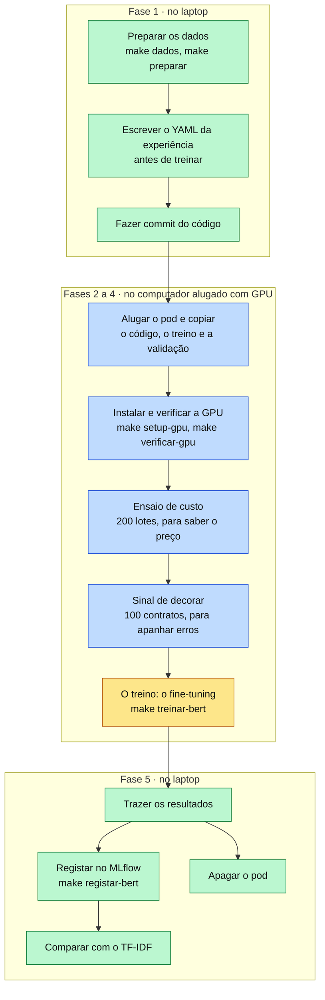
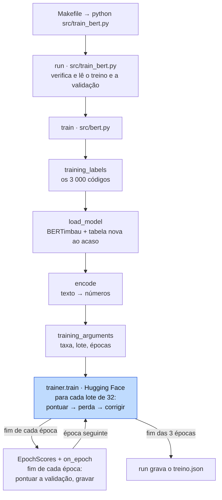

# O fine-tuning do BERT, do início ao fim

Tudo o que se faz para afinar o BERTimbau (ou o Albertina), pela ordem em que se faz: no laptop, no computador alugado com GPU e outra vez no laptop. Para cada passo diz-se o comando, o código que corre e porquê.

O que é o fine-tuning, com exemplos de números, está em [`fine_tuning_simples.md`](fine_tuning_simples.md). Os pormenores do computador alugado estão na secção 7 de [`maquina_runpod.md`](maquina_runpod.md). Os números citados vêm de [`qualidade_dados.md`](qualidade_dados.md) e de [`metrics/bert/e5_t4_bertimbau/treino.json`](../metrics/bert/e5_t4_bertimbau/treino.json), o primeiro treino a sério (E5-T4).

## O caminho todo



- **Verde:** no laptop.
- **Azul:** no computador alugado (o *pod*), antes do treino.
- **Amarelo:** o fine-tuning propriamente dito.

---

## Fase 1. No laptop: preparar

### 1.1 Os dados

```bash
make dados      # descarrega os ficheiros do Portal BASE e converte-os (demora)
make preparar   # src/prepare.py: cria treino, validação e teste em data/processed/
```

O `src/prepare.py` junta o texto de cada contrato, escolhe o código e separa os contratos por data:

| Ficheiro | Contratos | Para quê |
|---|---|---|
| `treino.parquet` | jan. 2022 a set. 2025, um exemplo por texto (478 384) | o modelo aprende com estes |
| `validacao.parquet` | out. 2025 (23 945) | medir no fim de cada época |
| `teste.parquet` | nov. e dez. 2025 | fechado até ao fim do projeto: **nunca vai para o pod** |

Cada exemplo de treino tem duas colunas que o fine-tuning usa: `texto` (o que o modelo lê) e `codigo` (a resposta certa).

### 1.2 Escrever o YAML antes de treinar

Antes de gastar dinheiro, escreve-se num ficheiro o que se vai treinar e com que valores: por exemplo [`experiencias/e5_t4.yaml`](../experiencias/e5_t4.yaml), com o modelo, a taxa de aprendizagem, o lote, as épocas e de onde veio cada valor.

Faz-se **antes** de ver qualquer resultado, para não se mudar a configuração depois só porque o número saiu mal. O YAML não muda o treino: só fica registado com ele, no `treino.json` e no MLflow.

### 1.3 Commit

O código é gravado num commit do git. O treino grava esse commit no `treino.json`, para se saber sempre com que versão do código foi feito. Na GPU, o treino recusa-se a arrancar sem commit e sem YAML.

---

## Fase 2. No computador alugado: preparar

O laptop não tem GPU, e um treino do BERT no processador levaria dias. Por isso aluga-se um computador com GPU na Runpod. No E5-T4 foi uma RTX 4090. Paga-se à hora, esteja a trabalhar ou parado, por isso apaga-se logo no fim.

### 2.1 Copiar o código e os dados

```bash
rsync -a --no-owner --no-group -e "$E" --exclude '.venv/' --exclude 'data/' ./ root@IP:/workspace/projeto_CPV/
rsync -a --no-owner --no-group -e "$E" data/processed/treino.parquet data/processed/validacao.parquet \
      root@IP:/workspace/projeto_CPV/data/processed/
```

Vão só o código, o treino e a validação. O projeto fica em `/workspace` porque é o único disco que sobrevive se o pod reiniciar, e os checkpoints (as cópias do modelo de cada época) têm de sobreviver para se poder retomar.

Logo a seguir, compara-se a impressão digital (SHA-256) dos ficheiros nos dois lados, para confirmar que são exatamente os mesmos dados.

### 2.2 Instalar e verificar

```bash
make setup-gpu        # instala as bibliotecas, incluindo o torch com suporte para GPU
make verificar-gpu    # falha se o torch não vir a GPU
git rev-parse HEAD    # tem de mostrar o mesmo commit do laptop
```

O `make verificar-gpu` chama `bert.check_gpu()`, em `src/bert.py`. Se não houver GPU, não se treina.

---

## Fase 3. No computador alugado: dois ensaios antes do treino

### 3.1 Ensaio de custo

```bash
make treinar-bert MODELO=bertimbau SAIDA=metrics/bert/e5_t4_ensaio ARGS="--experiencia experiencias/e5_t4.yaml --max-passos 200"
```

É o mesmo código do treino, mas pára ao fim de 200 lotes. Mede quantos segundos demora cada lote, e isso vezes os 14 945 lotes de uma época dá o tempo e o preço de uma época. No E5-T4, um treino completo de 3 épocas custava cerca de 0,83 $.

### 3.2 Sinal de decorar

```bash
make sinal-decorar MODELO=bertimbau TAXA=1e-4 ARGS="--experiencia experiencias/e5_t4.yaml"
```

O `scripts/sinal_decorar.py` treina o modelo com só **100 contratos** e pergunta se ele os consegue decorar todos. Um modelo bem ligado decora 100 contratos com facilidade. Se não conseguir, provavelmente há um erro antes do treino: por exemplo, códigos trocados entre contratos ou textos cortados. É mais barato descobrir isto com 100 contratos do que com 478 mil.

No E5-T4, o modelo acertou 86 de 100 em 30 épocas, abaixo dos 95 pedidos (secção 21). Com 100 épocas chegou a 100 de 100: o modelo estava bem ligado, só precisava de mais voltas.

---

## Fase 4. No computador alugado: o treino (o fine-tuning)

```bash
make treinar-bert MODELO=bertimbau SAIDA=metrics/bert/e5_t4_bertimbau ARGS="--experiencia experiencias/e5_t4.yaml"
```

Corre-se dentro do `tmux`, um programa que mantém o treino vivo mesmo que a ligação ao pod caia. O que acontece no código, por ordem:



### 4.1 `run`, em `src/train_bert.py`: verificar e ler

Confirma que há GPU, que há YAML e commit, e que nenhum dos ficheiros é o de teste. Depois lê os dados e chama o fine-tuning:

```python
treino = pd.read_parquet(train_path, columns=["data", "texto", "codigo"])
val = pd.read_parquet(val_path, columns=["idcontrato", "data", "texto"])
out = bert.train(treino["texto"], treino["codigo"], modelo, checkpoints_dir,
                 textos_val=val["texto"], on_epoch=on_epoch, ...)
```

### 4.2 `train`, em `src/bert.py`: montar as peças

**Os códigos** (`training_labels`). Os códigos com menos de 10 exemplos sobem para a sua classe ou o seu grupo, e sai a lista das 3 000 etiquetas:

```python
etiqueta, classes = training_labels(codigo, n_min)
```

**O modelo** (`load_model`). Descarrega o BERTimbau, que já sabe português, e cria por cima uma tabela nova de 3 000 linhas × 768 números ao acaso, uma linha por código:

```python
model = AutoModelForSequenceClassification.from_pretrained(
    nome,                         # o BERTimbau, com a revisão fixada em src/bert_models.py
    num_labels=len(classes),      # a tabela nova: 3 000 linhas ao acaso
    ...)
```

**Os textos em números** (`encode`). Cada texto é partido em bocados de palavras (*tokens*), cada bocado é trocado pelo seu número no dicionário do BERTimbau, e o texto é cortado aos 256 bocados. Cada código é trocado pelo número da sua linha na tabela:

```python
treino = EncodedTexts(encode(tokenizer, texto[keep], info["max_length"]),
                      etiqueta[keep].map(id_de).to_numpy())
```

**As regras** (`training_arguments`): taxa de aprendizagem 0,00002, 32 contratos por lote, 3 épocas.

### 4.3 `trainer.train()`: o fine-tuning

```python
trainer = Trainer(model=model, args=args, train_dataset=treino, ...)
trainer.train()
```

Esta linha é o fine-tuning. Por dentro, o Hugging Face faz isto:

```python
otimizador = AdamW(model.parameters(), lr=2e-5)   # TODOS os pesos: os do BERTimbau e os da tabela nova

for epoca in range(3):                            # 3 voltas a todos os contratos
    for lote in lotes_de_32:                      # 14 945 lotes por volta (478 234 ÷ 32)
        saida = model(input_ids=lote_textos, labels=lote_codigos)   # 1. pontuar os 32 contratos e medir a perda
        saida.loss.backward()                                       # 2. calcular para que lado mexer cada peso
        otimizador.step()                                           # 3. mexer cada peso um bocadinho
        otimizador.zero_grad()                                      # 4. limpar as contas para o lote seguinte
```

1. **Pontuar e medir a perda.** O BERTimbau transforma cada texto em 768 números, a tabela dá 3 000 pontuações, e compara-se com o código certo. A **perda** é a medida de quão mal ficou pontuado o código certo.
2. **Calcular para que lado mexer.** O PyTorch calcula, para cada peso do modelo, se subi-lo faria a perda subir ou descer.
3. **Mexer um bocadinho.** Cada peso é corrigido no sentido que faz a perda descer, em passos de tamanho 0,00002. A tabela nova muda muito, porque começou ao acaso. O BERTimbau muda pouco, e só se afina.
4. **Limpar** e passar ao lote seguinte.

Ao todo são 3 × 14 945 = 44 835 correções. O Trainer acrescenta a este ciclo:
- baralhar os contratos em cada época;
- fazer a taxa subir aos poucos nos primeiros 10% dos lotes e descer até 0 no fim;
- usar a GPU;
- gravar um checkpoint por época.

### 4.4 No fim de cada época: `EpochScores` e `on_epoch`

```python
pontuacoes = predict_scores(model, self.input_ids, ...)   # EpochScores, src/bert.py
self.on_epoch(epoca, checkpoint, pontuacoes)               # on_epoch, dentro do run
```

O modelo, tal como está nesse momento, pontua os contratos de validação. O `on_epoch` grava as 5 sugestões de cada contrato em `metrics/bert/<saída>/epoca_<k>/`. O Trainer grava o checkpoint em `models/bert/`. Se o pod cair, o mesmo comando com `--retomar` continua da última época gravada.

### 4.5 No fim: o `treino.json`

Quando as 3 épocas acabam, o `run` grava o `treino.json`: exemplos usados (478 234), etiquetas (3 000), lotes por época (14 945), perda de cada época, tempo, GPU, commit e YAML.

---

## Fase 5. No laptop: trazer, registar, comparar e apagar

### 5.1 Trazer os resultados

```bash
rsync -a -e "$E" root@IP:/workspace/projeto_CPV/metrics/bert/e5_t4_bertimbau/ metrics/bert/e5_t4_bertimbau/
```

Vem só a pasta pequena: as sugestões de cada época e o `treino.json`. Os checkpoints e as pontuações (vários GB) ficam no pod.

### 5.2 Registar no MLflow

```bash
make registar-bert PASTA=metrics/bert/e5_t4_bertimbau
make mlflow           # abre http://127.0.0.1:5000
```

O `src/registo_bert.py` lê a pasta e cria um registo no MLflow (experiência `treinos_bert`), com os valores do treino e o top-5 de cada época. Antes, confirma que o `treino.parquet` e o `validacao.parquet` do laptop são os mesmos que foram para o pod.

### 5.3 Comparar com o TF-IDF

| | Top-5 por código, na validação |
|---|---|
| TF-IDF (o modelo em vigor) | 78,35% |
| BERTimbau, E5-T4 | 73,39% |

Os números são da secção 22 de `qualidade_dados.md`. Foi um único treino, e a decisão entre os modelos fica para o E5-T6.

### 5.4 Apagar o pod

Logo que os resultados estão no laptop e abrem, apaga-se o pod (*terminate*) e confirma-se que a lista de pods está vazia. Com o pod apagado, os checkpoints desaparecem com ele.

---

## Resumo: os comandos, por ordem

| Fase | Onde | Comando | Código que corre |
|---|---|---|---|
| 1 | laptop | `make dados`, `make preparar` | `src/prepare.py` |
| 1 | laptop | escrever `experiencias/<item>.yaml`, commit | — |
| 2 | laptop → pod | `rsync` do código, `treino.parquet` e `validacao.parquet` | — |
| 2 | pod | `make setup-gpu`, `make verificar-gpu` | `bert.check_gpu` |
| 3 | pod | `make treinar-bert ... --max-passos 200` | `src/train_bert.py` (pára cedo) |
| 3 | pod | `make sinal-decorar ...` | `scripts/sinal_decorar.py` |
| 4 | pod | `make treinar-bert ...` | `run` → `train` → `trainer.train()` → `EpochScores` |
| 5 | pod → laptop | `rsync` da pasta de saída | — |
| 5 | laptop | `make registar-bert PASTA=...` | `src/registo_bert.py` |
| 5 | Runpod | apagar o pod | — |
